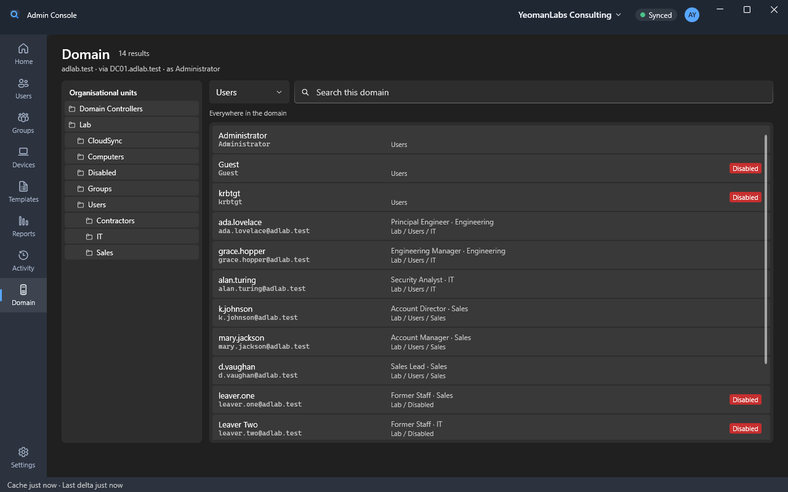

# Admin Console


Run **Entra ID, Intune, Exchange Online, OneDrive and Active Directory** from one search box, on the PC you already
work at.

Type part of a name and you are on the person or the machine, with everything about them on one screen: who they are,
what they can sign in with, their licences, groups, mailbox, OneDrive, AD account and devices. Then do the job there:
reset a password, issue a Temporary Access Pass, share a mailbox, fix a licence, offboard a leaver, or create a starter
in AD from a template — without opening five admin centres.

## What it does

- **Search that answers instantly.** Everything is indexed on your PC, so search never waits on Microsoft: a median of
  1.1 ms at 5,000 users, 2,000 devices and 1,000 groups ([PERF.md](docs/PERF.md)).
- **Lists you can ask questions of.** Users, groups and devices with one-click filters for the questions a helpdesk
  asks — who is disabled, who has no licence, which devices fail compliance. Type `dep=sales lic=e3 disabled=true` for
  anything the filters don't cover; choose the columns and export exactly what is on screen to CSV.
- **One page per person.** Identity, access, devices, activity, **mailbox** and **OneDrive**, editable in place. On a
  synced account, the fields AD owns are written to AD itself, with your own AD permissions.
- **Mailboxes.** Addresses, forwarding, automatic replies, regional settings, Full Access, Send As and Send on Behalf,
  conversion to shared — through Exchange Online's own admin API, as you.
- **OneDrive.** Lock it, set its sharing, add or remove site admins, and export the whole drive to a ZIP that resumes
  if interrupted and checks every file against OneDrive's own hash.
- **Offboarding as a checklist.** A snapshot of everything first, then the AD, Entra, Exchange and OneDrive steps,
  previewed and run in order with a live log. **Restore** puts it back from the snapshot. Offboard a list of leavers —
  pasted, or imported from a CSV — each with their own preview.
- **Offboarding templates.** Save what each kind of leaver gets — the steps, the manager as delegate, an automatic
  reply with `{name}` and `{delegate}` filled in per person, the attributes to stamp — and pick the one the offboard
  dialog opens with.
- **Starters from templates.** Snapshot someone who already has the role. In a synced organisation the account is
  created in AD, and the licences, groups and mailbox settings follow on their own once Entra Connect has synced it.
- **Bulk edit.** Tick people (or every match), set the fields, and read a per-person preview of what changes and
  whether it is written in Entra ID or in AD before anything is sent.
- **Temporary Access Pass and PIM.** Issue a pass shown once and logged nowhere. See your eligible roles and activate
  one within its policy; a permission you lack but are eligible for offers to activate it.
- **Reports.** MFA readiness, licence usage — click a subscription to see who holds it — and mailbox size and
  delegation. Built when you ask, kept with their date, exported as shown.
- **Several tenants.** The tenant name in the title bar is a switcher. Each tenant opens in its own tabs, with its own
  sign-in, cache and sync; a tab only ever reaches the tenant it was opened in.
- **Active Directory.** A Domain page for OUs, users, groups and computers, including LAPS, moves and group types —
  across several domains if you have them.
- **A written record.** Every change goes into a local action log with what was sent and what came back; reversible
  ones offer an undo.



## Install

Download the latest release from [Releases](../../releases): Windows 10 (2004 or later) or Windows 11, x64 or ARM64.

- **MSI** (`AdminConsole-<version>-x64.msi` or `-arm64.msi`): installs for everyone on the PC into
  `Program Files\Admin Console`, with a Start menu shortcut. Needs admin rights.
- **Zip** (`AdminConsole-<version>-x64.zip` or `-arm64.zip`): unzip anywhere and run `AdminConsole.exe`. No install
  or admin rights needed.

Everything it needs (.NET 8 and WPF) is included.

The console isn't code-signed yet, so the first time you run a downloaded copy Windows SmartScreen may say it
"protected your PC". Select **More info → Run anyway**. You can check a download against `SHA256SUMS.txt` in the
release:

```powershell
Get-FileHash .\AdminConsole-<version>-x64.msi -Algorithm SHA256
```

### Deploy with Intune

Add the MSI as a **Line-of-business app**, or wrap it as a **Win32 app** with:

- Install: `msiexec /i AdminConsole-<version>-x64.msi /qn`
- Uninstall: `msiexec /x AdminConsole-<version>-x64.msi /qn` (or by product code)
- Detection: MSI product code, or the file `%ProgramFiles%\Admin Console\AdminConsole.exe` at that version or later.

New versions upgrade in place, and the installer closes a running console first. Uninstalling leaves each user's
`%LOCALAPPDATA%\AdminConsole`, which is theirs, not the program's.

## Set up (once per tenant)

The console signs in with each admin's own work account and can only do what their roles allow. It needs an app
registration **in the tenant it manages** — one per tenant, owned by that tenant, so nothing outside it holds access
to the directory. The package carries none: the first run opens a setup screen that asks for its client ID.

### With the script (recommended, about 2 minutes)

```powershell
.\scripts\New-AppRegistration.ps1 -WhatIf   # signs in, checks every permission, creates nothing
.\scripts\New-AppRegistration.ps1           # creates it, grants admin consent, prints the client ID
.\scripts\New-AppRegistration.ps1 -Update   # an existing registration: adds what a newer version needs
```

It needs an Application Administrator, Cloud Application Administrator or Global Administrator. Every permission is
delegated, so the same role that creates the registration can grant its admin consent.
Pass `-WriteConfig` and there is nothing to paste. Undoing it is the one `Remove-MgApplication` command it prints.

### By hand

1. **Entra admin center → App registrations → New registration.** Name it "Admin Console", accounts in any
   organizational directory (or single tenant), no redirect URI yet.
2. **Authentication → Add a platform → Mobile and desktop applications**, and add these redirect URIs with your
   Application (client) ID. Set **Allow public client flows** to **Yes**.
   - `ms-appx-web://microsoft.aad.brokerplugin/<client ID>`
   - `https://login.microsoftonline.com/common/oauth2/nativeclient`
   - `http://localhost`
3. **API permissions**, all **Delegated**, then **Grant admin consent**. There are no application permissions: the
   console only ever acts as the signed-in admin.

   **Microsoft Graph**

   | Permission | For | Asked for |
   |---|---|---|
   | openid, profile, offline_access | Signing in and staying signed in | At sign-in |
   | User.Read | Your own profile | At sign-in |
   | User.Read.All | Every person: the search index, lists and each person's page | At sign-in |
   | Group.Read.All | Groups and memberships | At sign-in |
   | Device.Read.All | Entra devices | At sign-in |
   | Organization.Read.All | Tenant details, licences and seats, when Entra Connect last synced | At sign-in |
   | DeviceManagementManagedDevices.Read.All | Intune devices | At sign-in |
   | DeviceManagementConfiguration.Read.All | Compliance and configuration state on a device | At sign-in |
   | UserAuthenticationMethod.Read.All | A person's sign-in methods; MFA readiness | At sign-in |
   | AuditLog.Read.All | Last sign-in, sign-in logs, MFA readiness, quiet licensed accounts | At sign-in |
   | User.ReadWrite.All | Edit people, create starters, bulk edit, licences, disable on offboarding | First change |
   | User-PasswordProfile.ReadWrite.All | Reset passwords | First change |
   | User.RevokeSessions.All | Sign someone out everywhere | First change |
   | GroupMember.ReadWrite.All | Add and remove group members | First change |
   | Group.ReadWrite.All | Edit groups and their owners | First change |
   | UserAuthenticationMethod.ReadWrite.All | Remove a sign-in method; issue a Temporary Access Pass | First change |
   | DeviceManagementManagedDevices.ReadWrite.All | Edit Intune devices | First change |
   | DeviceManagementManagedDevices.PrivilegedOperations.All | Sync, restart, retire, wipe | First change |
   | BitlockerKey.Read.All | Show BitLocker recovery keys | When you click Reveal |
   | DeviceLocalCredential.Read.All | Show LAPS passwords | When you click Reveal |
   | Files.Read.All | Export a OneDrive | At the first export |
   | RoleEligibilitySchedule.Read.Directory | Your eligible PIM roles | When you open My roles |
   | RoleAssignmentSchedule.ReadWrite.Directory | Activate one of them | When you open My roles |
   | RoleManagementPolicy.Read.Directory | What a role's policy asks for at activation | When you open My roles |

   **Office 365 Exchange Online:** `Exchange.Manage` — the Mailbox tab, the mailbox steps of offboarding and the
   mailbox report. Exchange's own roles decide what you can actually change.

   **SharePoint:** `AllSites.FullControl` — a OneDrive's lock, sharing and site admins, and opening it for export.
   SharePoint's own roles decide what you can actually change.

   Until a permission is consented, only the feature that needs it waits; it says which permission it is missing, and
   **Settings → Permissions** grants it.
4. Open the console, paste the **Application (client) ID** into the setup screen, and sign in.

### Roles your admins need

The permissions say what the console may ask for; each admin's own roles decide what they actually get. A missing role
is named next to the action it blocks, rather than surfacing as a bare error at the click.

| Feature | Role (or a custom role with the same rights) |
|---|---|
| Look things up, lists, reports on users and groups | Global Reader, or any role that reads the directory |
| Edit people, create starters, bulk edit | User Administrator |
| Reset passwords, revoke sessions | User Administrator, or Helpdesk Administrator for non-admins |
| Assign licences | License Administrator or User Administrator |
| Group members, edit groups | Groups Administrator, or owner of the group |
| Remove sign-in methods, issue a Temporary Access Pass | Authentication Administrator (Privileged Authentication Administrator for admins) |
| Edit Intune devices, sync, restart, retire, wipe | Intune Administrator |
| Show BitLocker keys and LAPS passwords | Cloud Device Administrator |
| Mailboxes | Exchange Administrator or Exchange Recipient Administrator |
| OneDrive settings and export | SharePoint Administrator |
| MFA readiness and licence reports | Reports Reader, Security Reader or Global Reader. Sign-in activity needs **Entra ID P1** |
| Activate a PIM role | Nothing extra — being eligible is the permission. The tenant needs **Entra ID P2** or ID Governance |
| Active Directory | Whatever you have been delegated on the OUs: the console connects as you |

**Another tenant?** Title bar → tenant name → **Add a tenant…**: its ID or domain, then the client ID of the
registration made there. Each tenant reopens with the account last used for it. The full detail is in
[docs/08-APP-REGISTRATION.md](docs/08-APP-REGISTRATION.md).

## Active Directory

Off until a domain is named for the tenant. **Settings → Active Directory → Connect a domain…** (or the button on the
Domain page) asks for the domain's DNS name — `(Get-ADDomain).DNSRoot` shows it — tests the connection, lets you pick
the leavers OU from the real tree, and reconnects the tenant. On the office network or the VPN, Windows finds a
controller by itself; name one only if your VPN does not pass on the DNS records it uses.

The connection is your own Windows sign-in: no password is stored, and AD enforces what you have been delegated. If
your AD rights are on a separate admin account, start the console as that account for network sign-ins:

```powershell
runas /netonly /user:CORP\admin-account "C:\Program Files\Admin Console\AdminConsole.exe"
```

Each tenant keeps its own domains, in `tenant.json` — several are fine, and each change goes to the domain that holds
the object. `appsettings.local.json`'s `OnPrem` section still works for the first tenant. A server name and a
credential exist there for labs and troubleshooting, never for a client deployment
([docs/11-ONPREM-AD.md](docs/11-ONPREM-AD.md)).

## Privacy

The console collects nothing: no telemetry, no licence server, no crash reporting. It talks only to Microsoft, as you —
`login.microsoftonline.com`, `graph.microsoft.com`, Exchange Online's admin endpoint `outlook.office365.com`, and your
tenant's own SharePoint hosts — and, on-prem, to your domain controllers.

Sign-in goes through the Windows account broker, and the token cache is protected with DPAPI. Passwords it generates
and Temporary Access Passes are shown once and never written down — not to the cache, the action log or the logs.
BitLocker keys and LAPS passwords are fetched only when you click Reveal.

Everything it keeps is in `%LOCALAPPDATA%\AdminConsole`:

| Path | What |
|---|---|
| `tenant.json` | The tenants this PC opens: registration, tenant, last account, on-prem domains. Never a password |
| `cache\{tenant}.db` | The search index, per tenant. Settings → Rebuild index starts it again |
| `actions.db` | The action log: every change, with its tenant and outcome |
| `templates\users\{tenant}\` · `templates\offboarding\` | User templates per tenant; offboarding templates, shared by every tenant. Hand-editable |
| `snapshots\{tenant}\` | What offboarding recorded before it changed anything, for Restore |
| `pending\{tenant}.json` | Starters created in AD, waiting for Entra Connect |
| `reports\{tenant}\` | The last build of each report, with its date |
| `settings.json` · `branding.json` | Sync intervals, theme and density; name and colours |
| `logs\` | Object IDs and error text — never tokens or passwords |
| `msal.cache` | Sign-in tokens, protected by DPAPI |

Set the environment variable `ADMINCONSOLE_DATA_ROOT` to a folder to keep all of this there instead: a second,
separate setup, or a test run that must not see this PC's real tenants.

## Branding it

The console ships branded to nobody: it calls itself **Admin Console** and paints itself slate and blue. A deployment
can carry a client's or an IT team's identity instead — from **Settings → Branding**, or one file,
`%LOCALAPPDATA%\AdminConsole\branding.json`:

```json
{
  "productName": "Contoso IT Console",
  "tagline": "Contoso identity and devices, in one place.",
  "chromeColor": "#2B1B4D",
  "accentColor": "#C08CFF"
}
```

Colours apply at start. Text on the chrome is computed light or dark from the colour you pick, and a value that isn't a
hex colour falls back to the default. The installer and icon can be branded at build time:
`scripts\Build-Release.ps1 -ProductName "Contoso IT Console" -Manufacturer "Contoso" -IconPath .\contoso.ico`.

## Keyboard

| Key | Does |
|---|---|
| `Ctrl+K` | Search anything. `u:` `d:` `g:` narrow it, `>` runs an action |
| `Ctrl+N` · `Ctrl+Shift+O` | New user from a template · Offboard the person on screen |
| `Ctrl+T` · `Ctrl+W` · `Ctrl+Tab` | New tab · close tab · next tab |
| `Alt+1`…`Alt+8` | Home, Users, Groups, Devices, Templates, Reports, Activity, Domain |
| `Alt+←` · `F5` · `Esc` | Back · re-read what is on screen · close a dialog |
| `Ctrl+Shift+S` · `Ctrl+,` | Sync now · Settings |

## Build from source

C#, .NET 8 and WPF — Graph, Exchange and SharePoint over plain `HttpClient`, with no SDKs and no hosted PowerShell.

```powershell
dotnet test tests/AdminConsole.Core.Tests
dotnet run --project src/AdminConsole.App
pwsh scripts/Build-Release.ps1      # MSI + zip for x64 and arm64, and SHA256SUMS, in artifacts\<version>
```

| | |
|---|---|
| `src/AdminConsole.Core/` | Everything but the UI, fully unit-tested |
| `src/AdminConsole.App/` | The WPF shell, view models and views |
| `installer/` · `scripts/` | The MSI; the app registration, release build and icon source |
| [docs/](docs/00-README.md) | The specification it was built from — [09-PLAN.md](docs/09-PLAN.md) for what each milestone proved, [DECISIONS.md](docs/DECISIONS.md) for why |

## Status

Built and verified against a live tenant and a lab domain, milestone by milestone; every gate and what it actually
proved is in [09-PLAN.md](docs/09-PLAN.md). Three checks are the owner's to run because they can't be simulated — a
workday of real tickets, a stranger using it cold, and two production tenants side by side. What is known to be rough
is in [BACKLOG.md](docs/BACKLOG.md).

Made by YeomanLabs.
